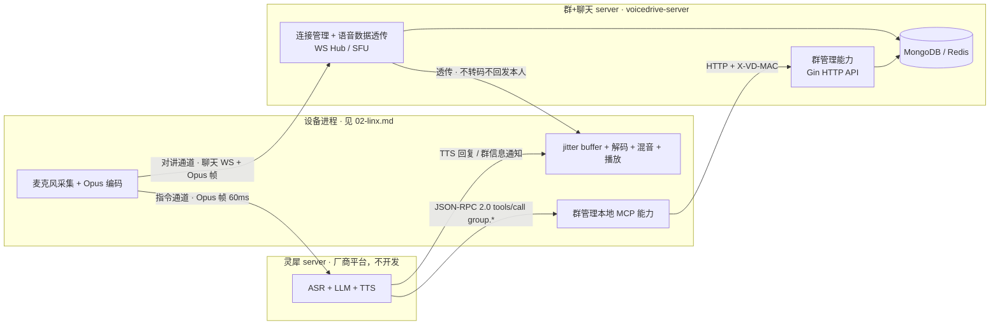

# 群 + 聊天 server 技术设计（voicedrive-server：群管理 + 连接管理/语音透传）

> 依据 `product-v2.md`（2026-10-24 决议版）与总体框架 `technique.md` 编写。本模块即 technique.md 中的 **群 + 聊天 server（voicedrive-server）**，含两大能力域：**群管理能力**（域模型、存储、Gin HTTP API）与 **连接管理 + 语音数据透传能力**（WS Hub / SFU）。设备进程见 `02-linx.md`；灵犀 server 为厂商平台，**不在开发范围**。
>
> 技术栈：Go 1.26 / Gin / MongoDB / Redis / `qiniu.com/cdnbase/xlog.v1`

---

## 1. 模块边界



职责划分（对齐 technique.md 总体框架）：

- **本模块（群 + 聊天 server）**：
  - **群管理能力（E）**：群/设备/成员/好友域模型与状态机、Gin HTTP API（MCP 工具 `group.*` 的服务端承载）、存储；
  - **连接管理 + 语音数据透传能力（F）**：设备 WS 连接生命周期、按焦点群路由、SFU 透传（只转发不转码不回发本人）、片段落库、控制消息下发；
  - 端上混音播放逻辑运行在设备进程，但属对讲链路设计的一部分，随本模块给出（§3.3）。
- **设备进程（`02-linx.md`）**：采集/编码、本地提醒词检测与双通道分流、灵犀 WS 客户端、群管理本地 MCP 服务器。
- **灵犀 server（厂商平台，不开发）**：ASR + LLM + TTS，仅经指令通道交互。

---

## 2. 组件与运行形态

| 组件 | 形态 | 说明 |
| --- | --- | --- |
| voicedrive-server（群+聊天 server） | 单个 Go 进程 | 群管理（Gin HTTP API）与连接管理/语音透传（WS Hub）两大能力域同进程，V0 单实例 |
| 设备模拟器 | Go 程序多开 | `--mac`（必填）`--alias` `--wake-word`（默认"小牛"）`--server`；对讲部分属本模块，指令部分属灵犀模块 |
| MongoDB | 持久层 | 设备/群/成员/片段/好友/邀请 |
| Redis | 在线状态层 | WS 路由、seq 分配、幂等去重 |

---

## 3. 连接管理 + 语音数据透传（通道 A 对讲媒体面）

### 3.1 音频规格（与灵犀平台对齐）

| 参数 | 值 |
| --- | --- |
| 采样率 | 16000 Hz，单声道，16-bit PCM |
| 编码 | Opus（低延迟语音 preset），带宽约 24kbps |
| 帧长 | 60ms（960 samples/帧） |
| 传输 | WebSocket 二进制帧，一 WS 消息 = 一 Opus 帧 |

### 3.2 WS 端点与消息模型

端点：`GET /v1/ws?mac=<MAC>`（V0 以 MAC 为设备身份，升级路径见 §9）

- **二进制帧** = 裸 Opus 音频帧。
- **文本帧** = JSON 控制消息，`type` 字段区分。

上行（说话人 → 服务端）：

```json
{ "type": "talk.begin" }
```
随后 N 个二进制 Opus 帧，结束时：
```json
{ "type": "talk.end" }
```

服务端在 `talk.begin` 时从 Redis `INCR talk:seq` 领取全局唯一 `seq`（全局单调 ⇒ 群内单调，兼作下行 demux 键，见 `03-voice-protocol.md` §2），向焦点群在线成员下发开场控制帧，随后逐帧转发（下行二进制帧带 6 字节头 `{seq u32, idx u16}`，多路说话人流交错 demux，见 03 §3）：

下行（服务端 → 听众，每个并发说话人一路）：

```json
{ "type": "talk", "group": "连霍big three", "seq": 42, "from_mac": "A", "alias": "翁师傅" }
```
随后转发该说话人的二进制帧流，`talk.end` 后下发 `{ "type": "talk.end", "seq": 42, "duration_ms": 3200 }` 收口。

**SFU 透传语义**（决议 §11-3，即 technique.md 的"语音数据透传"）：

- 每个说话人一条流，服务端**只转发、不转码、不回发本人**。
- 无讲锁、无排队：多人同时 `talk.begin` 时各走各的流，收端混音（§3.3）。
- 订阅关系 = 该群焦点群在此、且在线、且未静音的成员；服务端按焦点群路由，非焦点群不投（片段只落库，本期不补播）。

### 3.3 端上混音（设备侧播放链路）

每个活跃 `talk` 流一条播放管线：

```
WS 二进制帧 → per-stream jitter buffer(60~120ms) → Opus 解码 → PCM 16k mono
                                                    ↓
        各路 PCM 逐样本相加 + 饱和钳位(int16 [-32768,32767]) → 单条输出流连续播放
```

- 播放设备与 TTS 共用同一输出（仲裁规则见 `02-linx.md` §9）。
- jitter buffer 目标水位 3 帧（180ms），欠载补静音、溢出丢最旧帧——实时性优先于完整性。

### 3.4 片段落库与 seq

- 一次 `talk.begin` ~ `talk.end` = 一个对讲片段，**片段即消息**。
- `seq` 全局分配（`INCR talk:seq`）、群内单调递增，随片段落库；断线/截断片段标 `truncated: true`（03 §2/§5）；`last_acked_seq` 字段保留（补播 V1 启用，本期只写不读）。
- 音频正文 V0 直接存 MongoDB（`audio: BinData`，Opus 帧拼接），单片段超 512KB 转.GridFS（预留）。

---

## 4. 域模型与存储

### MongoDB Collections

| Collection | 关键字段 | 说明 |
| --- | --- | --- |
| `devices` | `mac`(唯一), `alias`, `focus_group_id`, `created_at` | 一设备一人；别名允许重名（决议 §11-9），消歧在使用处 |
| `groups` | `_id`, `name`, `passcode`, `created_by`, `created_at` | 同名群允许，口令区分 |
| `memberships` | `group_id`, `mac`, `joined_at`, `muted` | 唯一索引 `(group_id, mac)`；`muted` 只静"收"（决议 §11-4） |
| `fragments` | `group_id`, `seq`, `from_mac`, `alias`, `duration_ms`, `audio`, `created_at` | 留痕 + V1 补播数据源 |
| `friendships` | `a_mac`, `b_mac`, `met_in_group`, `met_at` | 入群成功即与全体现任成员两两建立；退群不解除 |
| `pending_invites` | `to_mac`, `group_id`, `from_mac`, `expires_at` | 拉人邀请，24h 过期（决议 §11-10） |

### Redis Keys

| Key | 类型/TTL | 用途 |
| --- | --- | --- |
| `online:{mac}` | string / WS 断开删除 | 在线状态与 WS 会话归属 |
| `talk:seq` | INCR | 对讲流/片段 seq 全局分配（全局单调 ⇒ 群内单调，03 §2） |
| `idem:{mac}:{tool}:{fingerprint}` | SETNX / 30s | 写操作幂等去重（约束 §8） |

---

## 5. 群管理 HTTP API（Gin）

MCP 工具 `group.*` 的服务端承载：灵犀 LLM 发起 tools/call → 设备端 MCP 服务器（`02-linx.md`）→ 转发到本 API。

### 5.1 身份与幂等（硬规则）

- **身份只认 Header**：`X-VD-MAC: <设备MAC>`，由设备进程持有并注入，**任何工具参数中的身份字段一律忽略**——模型无法传参伪造。
- **幂等**：同设备同工具 30s 窗口内参数指纹相同 → 直接返回上次结果（Redis SETNX）。
- 响应体统一：

```json
{ "status": "ok",       "message": "群建好了，连霍big three，口令 12345，告诉大家加入吧" }
{ "status": "clarify",  "message": "你说的是夜班组还是打灰组？", "options": ["夜班组", "打灰组"] }
{ "status": "error",    "message": "口令不对，再说说看" }
```

`message` 即合成音话术，**必须 ≤40 字**（约束 §8），由设备端直接送 TTS，服务端不做 TTS。

### 5.2 端点明细（与 MCP 工具一一对应）

| 端点 | 语义 | 关键行为（决议回填） |
| --- | --- | --- |
| `POST /v1/group/create` `{name, passcode?}` | 建群（F1） | 创建者自动入群；口令口述优先，未口述生成 4~6 位；群内同名允许 |
| `POST /v1/group/join` `{passcode}` | 口令入群（F2） | 校验→入群→**焦点自动切换**；与全体现任成员两两建好友；播报含安全提示合并话术；重复入群幂等返回"你已经在群里了" |
| `POST /v1/group/switch` `{name}` | 切焦点（F4） | 名字归一化→模糊匹配（命中多个→clarify，群按创建时间/人数排序取前 3）；**目标是静音群则自动解除静音**；单焦点 |
| `POST /v1/group/mute` `{name, on: bool}` | 静音/取消（F5） | 只静"收"；只对非焦点群生效；静音群拍一拍直接忽略 |
| `GET  /v1/group/list` | 查群（F6） | 返回群列表 + 焦点群必报；无群给引导话术 |
| `POST /v1/group/leave` `{name}` | 退群（F10） | **直接退，不反问**；退焦点群→焦点切最近活跃群或空；向焦点在该群的成员播报"XX已退出群聊" |
| `POST /v1/group/rename` `{name, new_name}` | 改名（F11） | **任何人可改**；改后群内播报 |
| `POST /v1/group/pat` `{alias}` | 拍一拍（F8，V0.5） | 目标别名归一化，命中多个→clarify（按共同群消歧）；对方收到切群确认（确认语境见 02-linx）；对方已静音本群→静默丢弃，**不打扰发起者也不打扰对方** |
| `POST /v1/group/invite` `{alias, group_name}` | 拉人（F9，V0.5） | 仅限自动好友；目标不在线→写 `pending_invites`（24h，下次上线提醒一次）；非好友→"让他报口令进群吧" |
| `POST /v1/group/query_member` `{group_name, alias}` | 查群友（F13，V0.5） | 非本群成员查询→拒绝；命中多个→clarify |

### 5.3 名字归一化链

```
精确匹配 → 别名/群名模糊匹配（前缀 + 编辑距离） → 命中多个 → clarify(选项≤3)
人按认识场景排序（共同群、met_at），群按 created_at/人数排序；仍分不清则不执行
```

---

## 6. WS 控制消息（服务端 → 设备）

| type | 时机 | 载荷 |
| --- | --- | --- |
| `talk` / `talk.end` | 对讲流开/收口 | 见 §3.2 |
| `announce` | 群内播报（入群/退群/改名/拍一拍/邀请） | `{ "group": "...", "text": "徐工已经退出了群聊" }`，text ≤40 字 |
| `pending_invite` | 上线补投递邀请 | `{ "from_alias": "...", "group": "..." , "expires_at": ...}` |
| `focus_changed` | 焦点变更确认 | `{ "group": "...", "closed_seqs": [...] }`（切群拆除的在途流，设备立即清 jitter buffer，03 §6.2），设备端随之播一次安全提示（恰好一次） |

`announce` 的出声由设备端本地 TTS 完成（V0 用系统 TTS，见 02-linx §11 待确认项）。

---

## 7. 连接管理与并发模型

- **连接生命周期**：上线注册（Redis `online:{mac}`）、心跳（30s ping/pong）、断线清理与订阅回收；重连后按服务端落库的焦点群自动恢复订阅（焦点不随连接丢失）。
- **talk 守卫**：活跃流 3s 无帧、WS 断开、重复 `talk.begin`、说话人退群 → 服务端强制收口/自愈（03 §5.2），收口语义与流-群绑定不变性见 03 §6。
- **Hub**：每群一个转发 goroutine，持有听众写通道表；说话人泵 goroutine 只写该通道——避免跨群锁。
- **慢消费者**：每听众带缓冲 channel（容量 64 帧 ≈ 4s），满则**丢最旧音频帧并递增 `dropped` 计数**，不阻塞转发路径（实时优先）。
- **写 WS 单 goroutine**：每连接一个写泵串行化所有下行（音频帧 + 控制帧），杜绝并发写同一连接。
- **落库异步**：片段音频先写内存/临时缓冲，`talk.end` 后异步落库，不占转发路径。
- **焦点切换竞态**：`switch` API 修改 `devices.focus_group_id` 与 Hub 订阅更新之间用设备级 mutex（单设备操作串行化）。

---

## 8. 性能预算（端到端 ≤1s）

```
采集帧 60ms + 编码 ≤5ms + 上行网络 ≤50ms(局域网)
+ 服务端转发 ≤5ms + 下行网络 ≤50ms
+ jitter buffer 60~120ms + 解码 ≤5ms + 播放缓冲 ≤60ms
≈ 0.3s，余量 ≥0.7s
```

指令通道预算（≤5s）由灵犀模块承担，本 API 目标：单请求 P99 ≤50ms。

---

## 9. 测试策略

- **表驱动**：名字归一化（精确/前缀/编辑距离/多命中）、口令生成（口述优先/系统生成/长度边界 4~6）、幂等指纹、话术长度校验（≤40 字）。
- **集成**：fake 设备（`--inject file.opus` 注入，无麦克风可测）×3 连真实 server，覆盖验收清单（product-v2 §9）：建群→入群→对讲→混音→静音→切焦点→硬边界。
- **竞态**：`go test -race`；并发 talk.begin × N + 并发 switch 的压力用例。
- 真实依赖（Mongo/Redis）用本地实例做集成测试，不用 mock（宪法 2.3）。

---

## 10. 待确认

| # | 事项 | 当前假设 |
| --- | --- | --- |
| 1 | WS 鉴权方式（MAC 明文够不够） | V0 仅 `?mac=`，V1 加设备密钥签名 |
| 2 | `announce` 播报的 TTS 引擎归属 | 设备端系统 TTS（macOS `say` / Linux `espeak`），音色与灵犀 TTS 的差异本身就是"机器话"信号 |
| 3 | 片段音频存储形态 | V0 BinData，超 512KB 转 GridFS |
| 4 | 多实例部署时 WS 路由 | V0 单实例；`online:{mac}` 已预留 instance 字段 |
| 5 | 异步群事件播报（退群/改名等）的合成路径 | technique.md 的 D→B 仅覆盖指令会话内回复；会话外事件走 F→B 下发文本 + 设备本地 TTS（§6 announce） |
