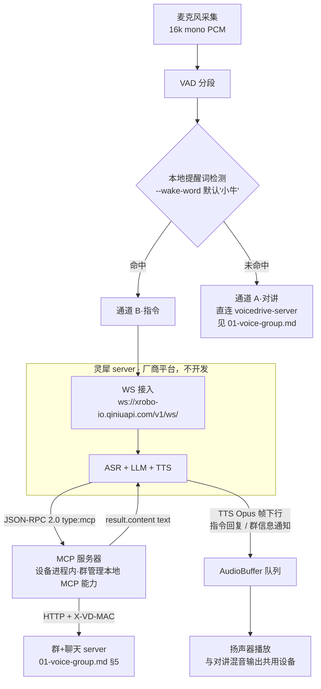
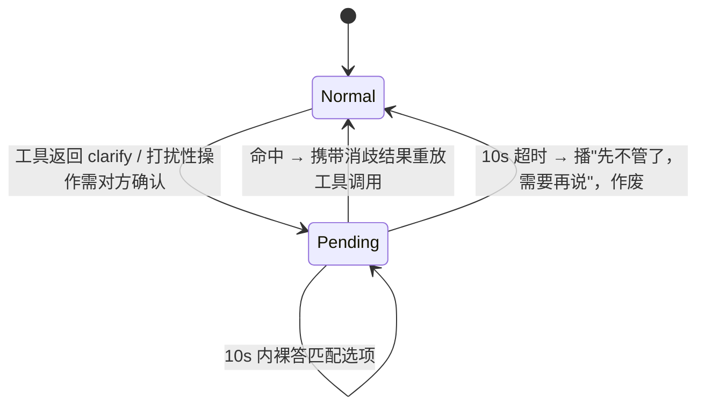

# 灵犀模块技术设计（设备端指令通道，Go 实现）

> 以 Go 1.26 重新实现 [linx-linux](https://github.com/sunqirui1987/linx-linux)（C++）的设备端能力，覆盖**麦克风的听、播放、与灵犀平台的交互**及 **MCP 服务器**（规则依据 [hardware-mcp](https://linx.qiniu.com/docs/xrobot/mcp/hardware-mcp)）。产品口径见 `product-v2.md`，总体框架见 `technique.md`，群 + 聊天 server 见 `01-voice-group.md`。**灵犀 server（ASR + LLM + TTS）为厂商平台，不在开发范围**——本模块只实现设备进程侧。
>
> 技术栈：Go 1.26 / gorilla/websocket / libopus（cgo）/ `qiniu.com/cdnbase/xlog.v1`

---

## 1. 模块边界与双通道分流

本模块承载**通道 B（指令）**全链路，并为通道 A 提供音频 I/O 底座：



**硬规则**（product-v2 §4.1）：

- 分流只发生在设备本地，检测不成立音频**绝不上行灵犀**；非提醒词开头的话永远不触发任何工具。
- 本地判定预算 <50ms；指令通道端到端 ≤5s。

---

## 2. 与 linx-linux 的移植映射

| linx-linux（C++） | 本模块（Go） | 说明 |
| --- | --- | --- |
| `linxsdk/audio`（`AudioInterface` 抽象，ALSA/PortAudio 工厂） | `internal/audio`（接口 `Capture/Playback`，实现 `malgo`：CoreAudio/WASAPI/ALSA 统一） | 保留"抽象接口 + 平台实现"结构 |
| `linxsdk/opus` | `internal/opus`（`github.com/hraban/opus`，cgo libopus） | 16k/mono/60ms，voice preset |
| `linxsdk/websocket`（websocketpp） | `gorilla/websocket` | 文本=JSON 控制帧，二进制=音频帧 |
| `AudioBuffer`（queue+mutex+condition_variable+atomic） | `internal/linx/audiobuffer`（`sync.Mutex`+`sync.Cond`+`atomic.Bool`） | TTS 下行生产者-消费者，语义 1:1 对齐 |
| `listen_state`/`tts_state`（start/stop/idle） | `internal/linx/state.go` 状态机 | 见 §4.3 |
| spdlog | `qiniu.com/cdnbase/xlog.v1` | 规范强制 |
| `linxsdk/http` / `json` | `net/http` / `encoding/json` | 标准库 |

---

## 3. 音频 I/O（听与播）

| 参数 | 值（与灵犀平台、01-voice-group §3.1 完全一致） |
| --- | --- |
| 采样率 | 16000 Hz，单声道，16-bit PCM |
| 采集块 | 320 samples（20ms）× 3 = 一 Opus 帧 960 samples（60ms） |
| 编码 | Opus，60ms/帧，单帧单 WS 二进制消息 |

- `audio.Capture`：独立 goroutine 泵，PCM 块经 channel 分发给**两个消费者**——提醒词检测器（§5）与（命中后）编码上行；不命中则转发给对讲通道。
- `audio.Playback`：单一输出流。**两路来源在此汇合**：灵犀 TTS 帧、对讲混音输出（01-voice-group §3.3）。合成音与对讲原声**逐样本相加播放**（不做打断），保证群内对讲不被系统播报切掉。
- 无麦克风降级（product-v2 §2.1）：终端文本输入以提醒词开头 → 视作 ASR 结果直接进指令通道（跳过采音）；不以提醒词开头 → 提示"对讲需音频，请用麦克风或注入文件"。`--inject file.wav`（16k/mono/s16 WAV，取 data chunk 按 20ms/640B 帧真实节奏上行）与 `--mic N`（ffmpeg avfoundation 采集，实时上行）都等同一次开口：直通进指令会话（§1 分流豁免），发完补 listen stop。
- 对讲通道（通道 A）的帧封装、talk 会话边界（VAD 起止/预滚/尾静默/120s 上限）、下行流 demux 与切群在途流处理见 `03-voice-protocol.md`。

---

## 4. 灵犀 WS 会话

> 会话对端为灵犀 server（厂商平台，ASR + LLM + TTS，不开发），本模块只实现客户端侧。

### 4.1 连接与握手

引导流程对齐 linx-emu 参考实现（dilfish/voicedrive `cmd/linx-emu`），分两步：

1. **OTA 上报**（`POST https://xrobo.qiniuapi.com/v1/ota/`，Headers：`Activation-Version: 1`、`Device-Id: <mac>`、`Client-Id: <uuid>`、`User-Agent`、`Accept-Language: zh-CN`；body 携带 `version/uuid/application/board/mac_address/chip_model_name`）：
   - 未绑定 → 返回 `{"activation":{"code","message"}}`，终端打印 6 位激活码，每 5s 轮询直至控制台「添加设备」完成绑定；
   - 已绑定 → 返回 `{"websocket":{"url","token"}}`，token 用于握手，url 非空时覆盖默认端点。
   - `--token`/`LINX_TOKEN` 显式给 token 时跳过 OTA。
2. **WS 握手**：端点 `ws://xrobo-io.qiniuapi.com/v1/ws/`（生产 wss），握手带 5 个头：`Authorization: Bearer <token>`、`Protocol-Version: 1`、`Device-Id: <mac>`、`Client-Id: <uuid>`、`User-Agent`。

连接建立后立即发送 hello（上行裸 PCM，20ms 一帧 320 采样）：

```json
{
  "type": "hello",
  "version": 1,
  "features": { "mcp": true },
  "transport": "websocket",
  "audio_params": {
    "format": "pcm", "sample_rate": 16000, "channels": 1,
    "bit_depth": 16, "endianness": "little",
    "frame_duration": 20, "frame_size": 320,
    "sample_format": "signed_int16", "play_buffer_duration": 300
  }
}
```

平台回 `{"type":"hello","session_id":...}` 确认握手并分配会话 id，端上随即自动发送 `{"type":"listen","state":"start","mode":"manual","session_id":...}`；此后 `listen.detect`（文本上行，等价"用户说了这句话"）与 `abort` 均须携带该 session_id。

### 4.2 消息路由

- **二进制帧** = 裸 PCM 音频（16k/单声道/16bit 小端，20ms 一帧 640 字节；上行：指令会话期采集流；下行：TTS 音频 → `AudioBuffer`）。
- **文本帧** = JSON 控制。按字段分派：
  - ASR/LLM/TTS 生命周期事件（`listen`/`tts` 的 start/stop）→ 驱动状态机；
  - `type: "mcp"` 的外层信封 → 剥出 JSON-RPC 2.0 payload 交给 MCP 分发器（§6）。
- 具体事件字段名以平台联调为准（client-demo 页未完整公开），接入层用 `json.RawMessage` 保留透传，避免过早绑定。

### 4.3 会话状态机

```
idle ──唤醒命中──> listening ──ASR stop──> thinking(LLM/tools) ──TTS start──> speaking ──TTS stop──> idle
                                                              │
                                        clarify(pending question) <── 10s 窗口，见 §7
```

- `listening`：持续上行 PCM 帧；VAD 静默或平台 `listen stop` 指令结束。
- `speaking`：`AudioBuffer` 有数据即连续播放至 `tts_state=idle`；播放期间采集不中断（用户可抢话，是否打断由平台决定，端上不本地打断）。
- 重连：指数退避（1s/2s/…上限 30s），重连成功重发 hello；离线期间对讲通道不受影响（两条连接彼此独立）。

---

## 5. 本地提醒词检测

提醒词是**端上定义的变量**（决议 §11-1）：`--wake-word`，默认"小牛"，每设备可不同。

```go
type Detector interface {
    Feed(pcm []int16) (hit bool)  // 流式喂入 20ms 块；命中返回 true 并内部 Reset
    Reset()
}
```

实现策略（按依赖成本递增，接口隔离可替换）：

| 实现 | 用途 |
| --- | --- |
| `prefixText`（V0 默认） | 终端文本输入的前缀匹配——无麦克风演示、自动化验收 |
| `kws`（可选增强） | 麦克风场景的流式关键词检测（如 sherpa-onnx KWS，cgo）；V0 允许用"注入提醒词音频文件"代替 |

- 检测窗口内未命中 → 该音频段整体判为对讲，绝不二次送检（防止半句入指令通道）。
- 命中后**提醒词本身不上行**，仅其后语音进入指令会话。

---

## 6. MCP 服务器（规则：hardware-mcp）

角色：**灵犀 = MCP 客户端，本设备 = MCP 服务器**；JSON-RPC 2.0 封装在 `type:"mcp"` 外层信封内，走灵犀 WS 文本帧。

### 6.1 协议四步

1. **hello**（设备→平台，§4.1 已含 `features.mcp:true`）。
2. **initialize**（平台→设备）：响应

```json
{ "jsonrpc": "2.0", "id": 1,
  "result": { "protocolVersion": "2024-11-05",
              "capabilities": { "tools": true },
              "serverInfo": { "name": "voicedrive-device", "version": "0.1.0" } } }
```

3. **tools/list**：单页返回全部工具（`nextCursor` 分页协议实现，工具数少用不到）；每个工具带 `name` + `description`（面向 LLM 的自然语言用途说明）+ `inputSchema`（JSON Schema，properties **仅 bool/int/string**——规范硬限制）。
4. **tools/call**（平台→设备）：`params: {name, arguments}` → 分发到注册 handler。

### 6.2 工具注册表

```go
type Tool struct {
    Name        string
    Description string          // 给 LLM 看，必须写清触发场景与参数含义
    Properties  []Property      // name/type/required + 范围与默认值
    Handler     func(args Args) string   // 返回 ≤40 字话术
}
```

与 01-voice-group §5.2 一一对应的 10 个工具：

| 工具 | 参数（全 string，除 on 为 bool） | description 要点 |
| --- | --- | --- |
| `group.create` | `name`, `passcode?` | 建群；口令可由用户口述，未口述勿填，由系统生成 |
| `group.join` | `passcode` | 口令入群；入群即可直接说话 |
| `group.switch` | `name` | 把我的焦点切到某群；名字可模糊 |
| `group.mute` | `name`, `on: bool` | 静音/取消静音某群的收听 |
| `group.list` | — | 查我加入的所有群与当前焦点群 |
| `group.leave` | `name` | 退出某群 |
| `group.rename` | `name`, `new_name` | 改群名 |
| `group.pat` | `alias` | 拍一拍某人（对方决定是否切群） |
| `group.invite` | `alias`, `group_name` | 邀请好友进群（对方须确认） |
| `group.query_member` | `group_name`, `alias` | 查某群里有没有某人 |

### 6.3 调用结果与错误

- **成功**（含业务失败话术，让 LLM/TTS 直接可读）：

```json
{ "jsonrpc": "2.0", "id": 7, "result": { "isError": false,
    "content": [ { "type": "text", "text": "已加入连霍big three，共 3 人，现在直接说话大家都能听到" } ] } }
```

- **协议错误**（未知工具等）走 JSON-RPC `error`，如 `-32601`：

```json
{ "jsonrpc": "2.0", "id": 7, "error": { "code": -32601, "message": "unknown tool" } }
```

- `clarify`（01-voice-group §5.1）映射为 `isError:false` + 反问话术文本，随后进入 §7 确认语境。

### 6.4 工具 → voicedrive 转发

- Handler 统一经 `internal/groupclient` 调 voicedrive HTTP API，**设备身份只从 Header `X-VD-MAC` 注入**（本机 `--mac`），LLM 的 `arguments` 中任何身份字段不透传——"身份只认平台 Header，不接受模型传参"。
- 超时 3s（≤5s 端到端预算内），失败话术："网络不太好，再说一遍试试"。

---

## 7. 确认语境状态机（product-v2 §4.3）



- `Pending{question, options[≤3], tool, originalArgs, deadline}`。
- **裸答豁免**：Pending 期间采集/文本输入**免提醒词**直接视作回答（"要/不要/第一个"）；未命中任何选项 → 当作新输入重新走分流。
- 打扰性操作（invite/pat）的**被邀请方**确认同样走此状态机（收到 `announce`/`pending_invite` 后自动进入 Pending）。
- 超时作废后播报，原指令参数丢弃，不隐式重试。

---

## 8. Go 包结构

```
cmd/voicedrive-device/        # 模拟器入口：--mac --alias --wake-word --server --inject/--mic；终端 UI（滚动区+状态区）
internal/audio/               # Capture/Playback 抽象 + malgo 实现
internal/opus/                # libopus 编解码（Encode(960 samples)→Opus 帧 / Decode 逆）
internal/vad/                 # VAD 分段（onset/offset 事件流）：驱动提醒词检测窗口（§1）与 talk 会话边界（03 §5.1）
internal/wakeword/            # Detector 接口 + prefixText 实现（kws 可选）
internal/linx/                # 灵犀 WS 客户端：hello、消息路由、状态机、重连
internal/linx/audiobuffer.go  # TTS 生产者-消费者缓冲（mutex+cond+atomic）
internal/talk/                # 对讲 WS 客户端（通道 A，直连 voicedrive-server）：talk 会话边界（预滚/尾静默/120s 上限）、下行 6 字节头 demux、已宣布 seq 集合与 unknown-seq 丢弃、切群前 talk.end 截断（03）
internal/talk/mixer.go        # per-stream jitter buffer + 多路 PCM 逐样本相加与饱和钳位（01 §3.3；idx 丢帧检测见 03 §3）
internal/mcp/                 # JSON-RPC 分发、Tool 注册表、schema 生成、错误码
internal/groupclient/         # voicedrive HTTP API 客户端（X-VD-MAC 注入、幂等透传）
internal/confirm/             # 确认语境状态机（§7）
```

依赖注入：全部组件由 `main` 构造后按构造函数参数传递，**无包级全局变量**（宪法 3.2）；日志经 context 携带 xlog。

---

## 9. 并发与竞态控制

| 共享点 | 风险 | 措施 |
| --- | --- | --- |
| WS 连接写（音频帧/控制帧/mcp 响应并发产生） | 并发写 panic | 单写泵 goroutine + 带 buffered channel，串行化一切下行 |
| `AudioBuffer`（TTS 生产者 vs 播放消费者） | 竞态 | mutex + cond（对齐 linx-linux 语义），`has_data` 原子标记 |
| 输出设备（TTS vs 对讲混音流） | 两写者互踩 | 播放侧单汇合点：两路 PCM 相加后由唯一播放 goroutine 写设备 |
| 对讲 jitter/混音（多路流解码 vs 播放泵） | 竞态 | 每路流独立 jitter buffer + 解码，仅在播放汇合点由唯一 goroutine 逐样本相加（01 §3.3） |
| 会话状态机（WS 事件 vs 采集泵 vs 定时器） | 状态撕裂 | 状态仅经单一事件 channel 变更（actor 化），无锁 |
| Pending 状态（10s 定时器 vs 裸答输入） | 双触发 | 定时器到期与输入处理同 channel 串行，先到先得 |

---

## 10. 测试策略

- **表驱动**（`testify/require`，整体结构体比较）：JSON-RPC 分发（合法/未知方法 -32601/畸形 payload）、工具 inputSchema 生成、确认状态机（命中/未命中/超时/免提醒词豁免）、提醒词前缀匹配（大小写、空格、半句话边界）。
- **集成**：`httptest` 起 fake 灵犀 WS server（回放录制的控制帧序列）+ fake voicedrive API，`--inject` 音频驱动全链路；真连 demo 环境的冒烟测试单独 tag（`//go:build e2e`）。
- **硬边界专项**（product-v2 §9）：输入"建个群吧"（无提醒词）必须进对讲通道，断言 fake 灵犀 server **零收到**音频、零 tools/call。
- 音频设备不 mock（宪法 2.3）：单测注入 PCM/Opus 字节流，设备 I/O 仅在 e2e 层触碰。

---

## 11. 待确认

| # | 事项 | 当前假设 |
| --- | --- | --- |
| 1 | ~~灵犀 WS 鉴权字段（token/mac 参数位置）~~ | **已确认（对齐 linx-emu）**：OTA 换 token + 握手 `Authorization: Bearer` 头，见 §4.1 |
| 2 | ASR/TTS 生命周期事件的确切字段名 | `json.RawMessage` 透传 + 联调后固化 |
| 3 | 麦克风场景的 KWS 选型 | 接口已隔离；V0 用注入文件/终端输入兜底 |
| 4 | 系统播报（announce）本地 TTS 引擎 | macOS `say` / Linux `espeak`，与灵犀 TTS 音色差异即"机器话"信号 |
| 5 | speaking 期间用户抢话是否打断 TTS | 平台侧决定，端上只上报不本地打断 |
