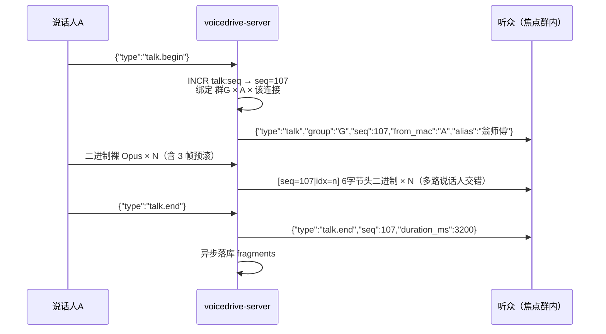
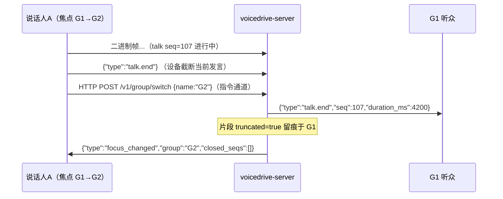

# 对讲语音线协议（通道 A · WS 控制帧与二进制帧规范）

> 依据 `product-v2.md`（2026-10-24 决议版）与 `technique.md`，细化 `01-voice-group.md` §3 的媒体面线协议；设备侧消费方为 `02-linx.md`。本文回答四个问题：**音频帧如何封装、流用什么稳定 ID、一次发言如何开始与结束、切群时在途流如何处理**。

---

## 1. 总览

一条 WS 连接（`GET /v1/ws?mac=`）承载对讲的一切：

- **文本帧** = JSON 控制消息（talk 生命周期、焦点变更等）；
- **二进制帧** = Opus 音频（上行裸帧；下行 6 字节头 + Opus，见 §3）；
- **一次发言（talk）** = `talk.begin` → N 个二进制帧 → `talk.end`，绑定唯一 `seq`。



---

## 2. 标识符（稳定 ID 规则）

| 标识 | 生成方 | 生命周期 | 规则 |
| --- | --- | --- | --- |
| `mac` | 设备 | 永久 | 唯一身份；V0 即鉴权凭证（`?mac=`），一切归属判定以此为准 |
| `seq` | 服务端 | `talk.begin` 分配，贯穿流与片段落库 | Redis 全局 `INCR talk:seq`；**全局唯一且全局单调 ⇒ 任一群内亦单调**，一物三用：流 demux 键、片段排序键、控制帧绑定键 |
| `alias` | 服务端下发 | 即时 | 仅展示用；允许重名、可变（决议 §11-9），**绝不可作标识或路由键** |
| `idx` | 说话人设备 | 流内 | 帧序号，从 0 起含预滚帧；听众据此检测丢帧/乱序 |

- **为什么全局分配而非按群分配**：切群瞬间旧群与新群的在途流会在同一条连接上交错，若每群独立计数，两群可能各自分到 `seq=42` 造成 demux 错流；全局单调用同一个计数器同时满足"群内单调"（片段排序）与"全局唯一"（demux），且省一次 Redis 往返的语义歧义。
- **seq 不复用、不续借**：断线重连不恢复旧 talk——对讲实时性下断线超秒级的内容无补播价值（本期），重连后新发言用新 seq；被打断的片段落库标 `truncated: true`（V1 补播可见）。

---

## 3. 二进制帧封装

**上行（说话人 → 服务端）：裸 Opus 帧，无头部。**
一条连接同一时刻至多一路活跃 talk（设备 VAD 保证，服务端守卫兜底，§5.2），帧的流归属由最近一次 `talk.begin` 的服务端会话态决定——连接即流载体，无需逐帧自证。

**下行（服务端 → 听众）：6 字节头 + Opus 载荷。**
同一连接上多路说话人的流交错下发，必须逐帧标识归属：

```
0         4         6
+---------+---------+---------------------+
| seq u32 | idx u16 |   Opus frame ...    |
+---------+---------+---------------------+
          big-endian（网络序）
```

- 开销 6B / 约 180B ≈ 3%，换取多路 demux + 丢帧检测。
- **不放时间戳**：实时流按到达时间做 jitter（01 §3.3），`idx` 管排序与丢失检测，能省则省（宪法第一条）。
- 一 WS 二进制消息 = 一帧（60ms / 960 samples），与 01 §3.1 一致。
- `idx` 为 u16 上限 65535 帧 ≈ 65 分钟，远大于单次发言上限 120s（§7），无回绕。

---

## 4. 控制消息

上行（设备 → 服务端）：

| type | 载荷 | 语义 |
| --- | --- | --- |
| `talk.begin` | — | 开始一次发言；身份取自连接（`?mac=`），不接受任何参数内身份字段 |
| `talk.end` | — | 结束当前发言；`duration` 由服务端按帧数计算，设备不上报 |

下行（服务端 → 设备）：

| type | 载荷 | 语义 |
| --- | --- | --- |
| `talk` | `{group, seq, from_mac, alias}` | 宣布一路新流；此后该 `seq` 的二进制帧连续下发直至 `talk.end` |
| `talk.end` | `{seq, duration_ms, reason?}` | 流收口，设备释放对应 jitter buffer；`reason ∈ normal / timeout / superseded / closed`，仅观测用，清理行为一致 |
| `focus_changed` | `{group, closed_seqs[]}` | 焦点变更；`closed_seqs` = 因切群被拆除的在途流 seq，设备立即清缓冲（§6.2） |

`announce` / `pending_invite` 等非对讲控制消息见 01 §6，不在本文重复。

---

## 5. 发言开始与结束

### 5.1 设备侧（VAD 会话规则）

- VAD 命中 onset → 发 `talk.begin`，随后把**预滚缓冲的最近 3 帧（180ms）**作为 `idx=0~2` 先行发出，避免吞字头。
- 会话期内**持续发帧**（含句中静默段），不做 DTX——jitter buffer 依赖均匀到达（01 §3.3）。
- 尾静默 ≥ 500ms → 发 `talk.end`。
- 单次发言硬上限 120s：到点设备自动收口，可立即开始下一次 `talk.begin`。
- 通道 A 的 talk 与通道 B 的指令会话可并存（双通道模型，technique.md）；音频归属判定见 02 §1/§5，与本节互不影响。

### 5.2 服务端（守卫与自愈）

| 异常 | 服务端行为 |
| --- | --- |
| `talk.begin` 时该设备已有活跃流 | 视为旧流被 `talk.end`（reason=superseded）后开新流——自愈语义，不回错误、不设 reject 消息 |
| 活跃流 3s 无任何帧 | 强制收口（reason=timeout），片段标 `truncated: true` |
| WS 断开且有活跃流 | 立即强制收口落库 |
| 无 `begin` 的二进制帧 | 丢弃 + 计数（`stray_frames`），不惩罚连接 |
| 无活跃流的 `talk.end` | 幂等忽略 |
| 说话人退群/被移除时仍有活跃流 | 权威强制收口（reason=closed）并通知听众 |

- 服务端**不向说话人回发其自身流的任何下行**（含强制收口通知，01 §3.2"不回发本人"）；说话人设备下次 `talk.begin` 经 superseded 自愈对齐。
- `duration_ms` 一律服务端计算（帧数 × 60ms）——单一事实源，防两端时钟/帧数口径漂移。

---

## 6. 切群时在途流的处理

> **总则：流与群的绑定在 `talk.begin` 一次性确定，之后不重定向、不重绑定。切群只影响"谁听到"，不影响"流去哪"。**

### 6.1 说话方切群（正在说，焦点切走）



1. 设备执行切群（F4 / 入群自动切）前**先发 `talk.end` 截断当前发言**，再走指令通道。
2. 服务端：切换 API 与 talk 泵经设备级 mutex 串行（01 §7）。`end` 先到 → 正常收口落库（`truncated: true`）；截断前仍在途的帧按 **begin 时绑定的群**路由完最后一帧后收口。
3. 说话人焦点已在新群，但旧群听众把这句"半个尾巴"听完整——**归属权跟流不跟人**。

### 6.2 收听方切群（正在听，焦点切走）

1. 服务端更新订阅：**停投旧群一切流**，下发 `focus_changed {group: 新群, closed_seqs: [旧群在途 seq…]}`。
2. 设备收到后**立即**释放 `closed_seqs` 对应的 jitter buffer 与解码管线（声音 100ms 内停）。
3. 网络内在途的旧群残留帧由 §6.3 兜底。

### 6.3 设备侧防串扰（双向竞态兜底）

设备只维护**当前焦点群内已宣布的 seq 集合**（经 `talk` 控制帧进入，含 §6.4 的补发宣告）；**不在此集合内的下行二进制帧一律直接丢弃**。一条规则同时覆盖：切群后残留帧、服务端/设备状态竞争窗口、未来多实例路由抖动。

### 6.4 切入方听到在途流（中途加入）

焦点切入某群（switch / join 自动切）时该群已有在途流：服务端对新焦点群的**每一路在途流补发 `talk` 宣告**（`{group, seq, from_mac, alias}`），随后从当前帧续投。切入方无头加入、从中间续听——实时优先，不回放缓存的前半段。设备将补发宣告的 seq 纳入 §6.3 集合。

### 6.5 说话人退群（F10）时的在途流

同 §6.1 语义：服务端权威强制收口（reason=closed），听众收 `talk.end` 自然释放；片段留痕于原群。

---

## 7. 常量（可调，默认值）

| 常量 | 默认值 | 说明 |
| --- | --- | --- |
| `PREROLL_FRAMES` | 3（180ms） | onset 前预滚，防吞字头 |
| `TRAILING_SILENCE` | 500ms | 尾静默判定发言结束 |
| `MAX_TALK_DURATION` | 120s | 单次发言上限，到点自动收口 |
| `WATCHDOG_NO_FRAME` | 3s | 服务端无帧强制收口 |
| `JITTER_TARGET` | 3 帧（180ms） | 见 01 §3.3 |
| `SLOW_CONSUMER_BUF` | 64 帧（≈4s） | 见 01 §7 |

---

## 8. 测试要点（宪法第二条）

- **表驱动**：6 字节帧头编解码（BE、idx 边界 0/最大、畸形短包丢弃）；unknown-seq 帧丢弃；`talk.end` 幂等。
- **性质测试**：并发多群 talk 下 seq 全局单调 ⇒ 各群内单调；切群交错窗口无 seq 撞车。
- **集成（真 Mongo/Redis，不用 mock）**：begin→帧→end 全链路落库；watchdog 3s 强收（truncated）；superseded 自愈；说话中切群断言旧群听众收到完整 `talk.end`；切入方收到补发宣告并续听；并发 N 路 talk + 并发 switch 以 `go test -race` 压测（01 §9）。
- **硬边界**：切群后旧群流零投递——断言 `closed_seqs` 之外无任何旧群帧到达。

---

## 9. 待确认

| # | 事项 | 当前假设 |
| --- | --- | --- |
| 1 | 120s 发言上限是否覆盖工地长篇训话场景 | 先 120s，联调后按反馈调常量 |
| 2 | 预滚 3 帧 / 尾静默 500ms 的听感（吞字或拖尾） | 常量已隔离，实测定 |
| 3 | V1 补播是否需要 truncated 片段续传 | 本期只留痕不补播（决议 §11-3） |
| 4 | 中途加入续听时是否带"已进行时长"提示（如提示音） | V0 无提示直接续听 |
