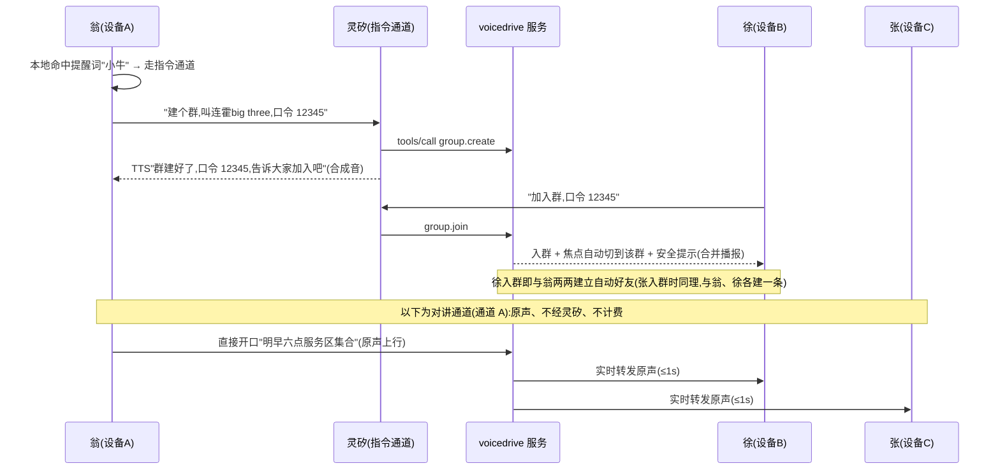
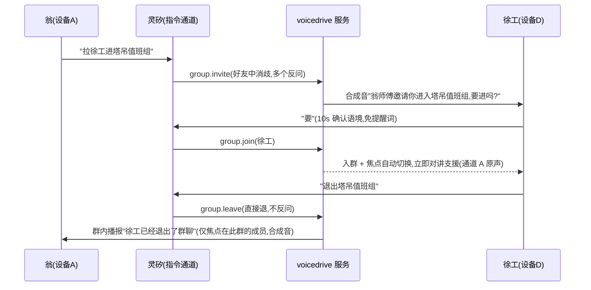
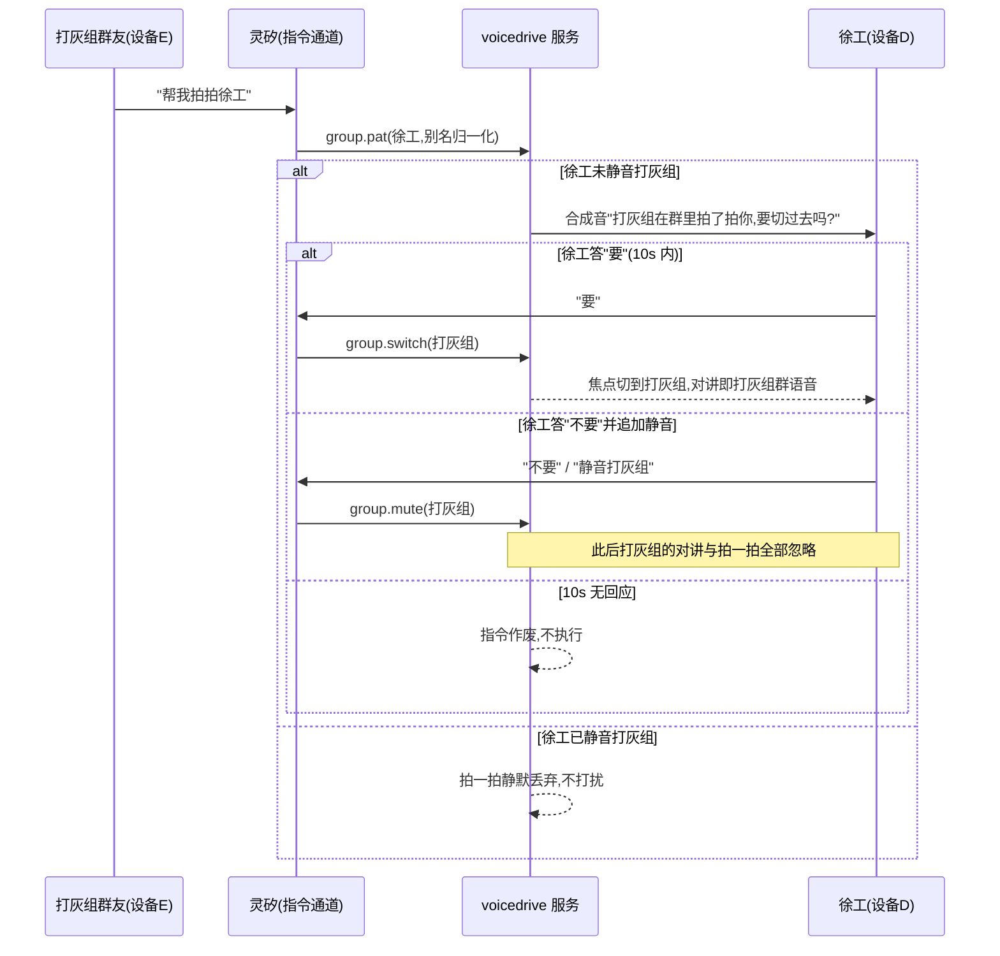
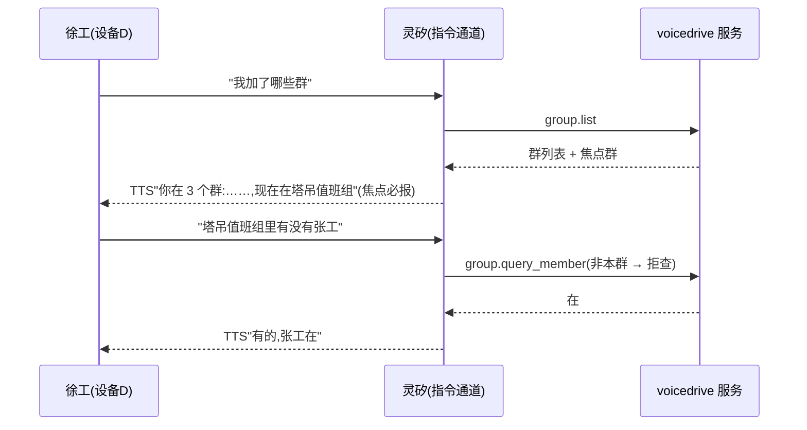
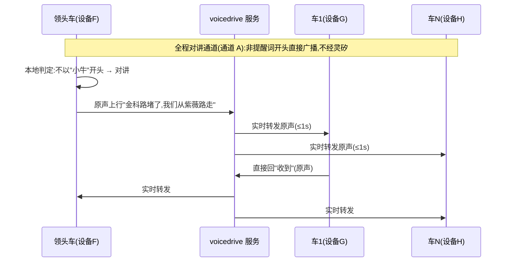

# Voicedrive 产品文档 v2(对讲版)

> 本文档基于 `product.md`(原始愿景草稿)叠加 `docs/architecture.md`(mvp 技术事实)扩展而成,是当前唯一有效的产品口径。源文档保留不动。
>
> **本文档的宗旨**:交互存在歧义时,产品必须向用户确认,而不是系统替用户猜。所有反问、确认、超时规则见 §4.3;已拍板决议集中列在 §11。

---

## 0. 与既有结论的关系

| 项 | mvp 架构文档的结论 | 本文档的结论 |
| --- | --- | --- |
| 实时对讲 | 不做(留言式,3~5s 延迟,合成音) | **必须做**(产品决策,2026-10-24)。对讲走自建音频通道,原声实时 |
| 群消息形态 | 文本经灵矽 → TTS 合成 → 音频文件 | 对讲片段即消息:原声音频 + 序号,实时推(补播兜底 V1,本期不做) |
| `group.send_voice` 工具 | 核心工具 | **退役**。聊天不再经灵矽,直接说就是对讲 |
| 灵矽的角色 | 承载一切(ASR/LLM/TTS 全链路) | 只承载**指令通道**(管理命令);对讲通道不过灵矽、不计费 |
| 群里听不到原声 | V0 最大妥协 | **解决**。人声=原声实时;只有机器播报(系统提示/指令反馈)是合成音 |

技术影响详见 §10。

---

## 1. 产品定位与双通道模型

**一句话**:面向司机(但不限于)的语音对讲机——直接开口,原声实时广播到群;"提醒词 + 命令"则由灵矽理解并执行群管理。

产品由两条完全独立的通道构成:

```
通道 A · 对讲(人 → 群)
  直接开口说话
  → 设备本地判定:不以提醒词开头
  → 音频实时上行到 voicedrive 服务 → 群内(焦点群)成员设备实时播放
  → 原声、低延迟、不经灵矽、不产生灵矽费用

通道 B · 指令(人 → 灵矽 → 服务)
  "提醒词 + 命令"(如 "小牛,帮我建个群叫夜班组")
  → 灵矽 ASR/LLM 解析 → 云端 MCP 工具调用
  → 合成音反馈给本人 / 系统播报给相关人
```

**两条声音原则**(用户可天然区分):

1. **人声 = 原声实时**。群里听到的是说话人本人的声音。
2. **机器话 = 合成音**。系统提示("已加入夜班组")、指令确认、邀请通知一律 TTS 合成音——音色差异本身成为"这是系统在说话"的信号,不需要屏幕。

---

## 2. 用户与场景

| 用户 | 场景 | 核心诉求 | 覆盖版本 |
| --- | --- | --- | --- |
| 货运司机 / 车队 | 同线路组队、装卸货协同、路况互通 | 免手操作、实时互通 | **V0 主打** |
| 网约车 / 出租车 | 机场排队、同行互助、临时组队 | 建群零门槛、防骚扰 | V0 主打 |
| 工程 / 港口 / 矿区 | 班组调度、安全广播 | 优先级抢占、强插、录音留痕 | V1+ |

V0 成品形态:电脑上的模拟设备(Go 程序多开,**带麦克风采集**——对讲通道的前提)。真机仍然不做。原型如何操作见 §2.1。

**身份模型**:一台设备 = 一个人 = 一个别名(如"翁师傅")。没有账号密码、没有好友申请;**同过一个群的人自动成为好友**(仅用于之后拉人,见 F9),没有私聊。真实用户体系(微信扫码绑定等)不在本版范围。

### 2.1 原型交互(V0 PC 模拟设备)

V0 的"设备"是终端里的模拟器进程,多开窗口即多设备。原型交互只为开发与演示服务,不代表真机形态(真机无屏幕、无键盘)。

**启动参数**

| 参数 | 说明 | 默认 |
| --- | --- | --- |
| `--mac` | 设备唯一标识,一个人(必填) | — |
| `--alias` | 初始别名 | `设备<mac 后 4 位>` |
| `--wake-word` | 提醒词(决议 §11-1,设备级自定义即此入口) | `小牛` |
| `--server` | voicedrive 服务地址 | 本机默认端口 |

**输入(模拟"开口")**

| 方式 | 用途 | 通道行为 |
| --- | --- | --- |
| 麦克风采音(默认) | 日常演示 | 走完整链路:本地提醒词检测 → 对讲/指令分流,与真机一致 |
| 终端文本输入 | 无麦克风降级 | 以提醒词开头 → 视作 ASR 结果直接走指令通道(跳过采音/ASR);不以提醒词开头 → 提示"对讲需音频,请用麦克风或注入文件" |
| `--inject <audio.opus>` | 自动化验收 | 注入音频文件等同一次开口,走完整对讲链路(§10-2 的无麦测试前提) |

**输出(终端可视,弥补真机无屏)**

- 实时滚动区:对讲片段(说话人别名 + `seq` + 时长)、指令反馈话术、系统播报文本(合成音同时播放)
- 常驻状态区:当前焦点群、已加入群列表、静音群列表、正在说话的人(混音时多行)
- 反问及 10s 倒计时(4.3)、安全提示(4.1)在状态区同步展示,超时作废可见

**演示脚本(对应 §9 验收清单)**

1. 开 3 个终端窗口,`--mac A/B/C` 各启动一台
2. A:"(提醒词)建个群,叫连霍big three" → B、C 口令入群
3. A 直接开口 → B、C ≤1s 听到原声;B、C 同时开口 → A 端混音同时听到两路
4. B:"(提醒词)切到其他群/静音本群" → 观察状态区变化与出声变化
5. 硬边界直测:A 说"建个群吧"(无提醒词) → 必须广播进群、不触发任何工具

---

## 3. 核心概念

| 概念 | 定义 |
| --- | --- |
| 设备 | 一个模拟器进程,`--mac` 唯一标识,一个人 |
| 别名 | 人在群内的称呼("徐工");播报、拉人、查询都用别名 |
| 群(聊天室) | 对讲的投递单元;有名字、口令、焦点状态、静音状态 |
| 口令 | 入群凭证,4~6 位数字,面对面口头转述 |
| 焦点群 | 设备的当前群:直接开口只广播到焦点群;一台设备同一时刻只有一个焦点群 |
| 静音 | 针对单个群:静音后不播放、不提醒该群任何内容(含拍一拍) |
| 好友 | **入群成功即与群内全体现任成员两两自动建立**(落库:别名、共同群、认识时间,供 §11-9 消歧),仅用于"拉人进群",无列表无私聊;退群不解除 |
| 提醒词 | 指令通道的触发前缀,**端上定义的变量**(每个用户可不一样),默认"小牛"(决议 §11-1)。**设备本地识别**,不识别完毕不出口 |
| 对讲片段 | 一次连续开口产生的原声音频,带群内单调递增 `seq`;**片段即消息**,实时推;按 seq 落库留痕(补播 V1) |
| 拍一拍 | 跨群注意力信号(V0.5):拍某人 → 对方收到切群确认 |

---

## 4. 交互模型

### 4.1 硬性双模式(产品第一规则)

| 开口方式 | 通道 | 去向 |
| --- | --- | --- |
| 以提醒词开头 | 指令 | 灵矽解析 → MCP 工具 → 合成音反馈 |
| 不以提醒词开头 | **对讲** | **原声实时广播到焦点群全员的设备** |

- 这是硬规则,没有第三种解释,LLM 不做猜测路由。
- 分流发生在**设备本地**(本地提醒词检测),保证对讲通道零等待。
- **安全提示(必须做)**:进入对讲模式(入群/切焦点群)后首次开口前,设备播一次合成音提示:"现在直接说话,全群都能听到"。防止误以为在跟灵矽私聊。

### 4.2 交互动词表

| 用户说(示例) | 通道 | 动作 |
| --- | --- | --- |
| (提醒词)建个群,叫连霍big three | 指令 | 建群 |
| (提醒词)加入群,口令 12345 | 指令 | 入群 |
| (直接说)金科路堵了,走紫薇路 | 对讲 | 广播到焦点群 |
| (提醒词)切到打灰组 | 指令 | 切焦点 |
| (提醒词)静音打灰组 | 指令 | 群静音 |
| (提醒词)我加了哪些群 | 指令 | 查群 |
| (提醒词)拍拍徐工 | 指令 | 拍一拍(V0.5) |
| (提醒词)拉徐工进群 | 指令 | 拉人(V0.5) |
| (提醒词)退出这个群 | 指令 | 退群(V0.5) |

### 4.3 歧义确认机制(本文档宗旨)

产品级硬规则,所有指令通道功能必须实现:

| 规则 | 行为 |
| --- | --- |
| **命中多个目标必反问** | 群名/人名模糊匹配命中 >1 个 → 列举反问:"你说的是夜班组还是家庭群?"选项 ≤ 3 个 |
| **缺参数必反问** | 不编默认值:"群叫什么名字?" |
| **打扰性操作须对方确认** | 邀请入群、拍一拍 → 对方听到通知 + 确认,不同意则不生效 |
| **确认语境简答豁免** | 系统反问后的 10 秒内,裸答"要/不要/第一个"视为对该问题的回答,**无需提醒词**(否则确认流程不可用) |
| **超时放弃** | 反问 10 秒无回应 → "先不管了,需要再说"→ 指令作废,不执行 |
| **反馈话术 ≤ 40 字** | 所有合成音反馈;确认选项 ≤ 3 个 |

---

## 5. 功能清单

### V0(演示核心)

#### F1 面对面建群

- **触发**:"(提醒词)我们建个群,叫连霍big three"
- **系统**:建群,创建者自动入群并设为群主;生成口令——创建者口述了就用口述的("口令 12345"),未口述则系统生成 4~6 位数字(决议 §11-2);创建者设备播报
- **反馈(创建者)**:"群建好了,连霍big three,口令 12345,告诉大家加入吧"
- **边界**:同楼里别人建了同名群 → 允许,口令区分;建群即开启自动好友——此后任何人入群,即与群内现任成员两两建立好友(见 F2)
- **验收**:两人面对面 30 秒内完成建群 + 入群,全部口头完成

#### F2 口令入群

- **触发**:"(提醒词)加入群,口令 12345"
- **系统**:校验 → 入群 → **焦点自动切到该群**(入群即可聊);**入群成功即与群内全体现任成员两两建立自动好友**(落库:别名、共同群、认识时间)
- **反馈**:"已加入连霍big three,共 3 人,现在直接说话大家都能听到"(含 4.1 安全提示,合并播报)
- **边界**:口令错 → "口令不对,再说说看";重复入群幂等 → "你已经在群里了"
- **验收**:入群后直接开口,群内其他人立即听到原声

#### F3 实时对讲(核心中的核心)

- **触发**:焦点群内直接开口,无需任何操作
- **链路**:设备采音 → 上行 voicedrive 服务 → 焦点群在线成员设备 → 原声播放
- **延迟预算**:说完 → 对端出声 ≤ 1s(PC 模拟器,同机/局域网)
- **并发仲裁**(决议 §11-3):**混音**——允许多人同时说话,收端同时听到多路原声,不设讲锁、不排队。实现走 SFU 转发 + 端上混音(详见 §10-7)
- **片段落库**:每次开口为一个对讲片段,带 `seq` 存储——实时推送的同时留档(V1 录音留痕;补播本期不做,见 F7)
- **验收**:三窗口,一人说话两人同时听到原声,延迟无感知;两人同时说话时,收端同时听到两路原声,不丢失、不卡顿

#### F4 群焦点切换

- **触发**:"(提醒词)切到打灰组"(多群监听不支持,单焦点,决议 §11-6)
- **系统**:服务端落库设备的焦点群(不随连接丢失);此后对讲广播与提醒只投焦点群,其他群片段静默落库积累(本期不补播,见 F7);若切入的群处于静音,自动解除该群静音(见 F5)
- **反馈**:"好,现在在打灰组"
- **边界**:目标群名走归一化(别名表 → 模糊匹配 → 命中多个反问,群按创建时间/人数消歧,决议 §11-9);切换后自动播一次安全提示(4.1)
- **验收**:切换后 A 群说话听不到、B 群说话听得到;切回 A 群能听到新的实时对讲(历史片段本期不补,F7)

#### F5 群静音

- **触发**:"(提醒词)静音打灰组" / "(提醒词)取消打灰组的静音"
- **系统**:设备级按群静音,**只静"收"**(决议 §11-4):静音群的对讲、系统播报、提醒本机一律不播放;静音只对非焦点群生效——**焦点切到静音群时自动解除该群静音**,发言与收听一并恢复
- **反馈**:"打灰组已静音"
- **边界**:静音群仍留在群内;被静音群的拍一拍(V0.5)直接忽略
- **验收**:静音后该群连续说话 30s,设备零出声;焦点切到该群后恢复收听并可发言;手动取消静音后恢复

#### F6 查群

- **触发**:"(提醒词)我加了哪些群"
- **反馈**:"你在 3 个群:连霍big three、打灰组、塔吊值班组,现在在打灰组"(焦点群必报)
- **边界**:无群 → "你还没有群,说建个群试试"
- **验收**:建/入/退(退群 V0.5)后列表实时准确

#### F7 错过补播(本期不实现,推迟 V1)

> 2026-10-24 决议(§11-5):暂不实现片段补播;片段仍按 `seq` 落库留痕,保留后续实现空间。以下为目标设计,供 V1 参考。

- **触发**:"(提醒词)播下错过的" / "(提醒词)刚才打灰组说了什么"
- **系统**:按 `seq` 顺序向设备重投未听片段(原声);跨多群时按时间顺序合并
- **反馈**:"打灰组有 3 条,现在播给你"
- **边界**:仅保留最近 N 分钟片段(N 随 F7 一并推迟 V1 再定,决议 §11-5);超 5 条只播最新 5 条 + "更早的还有 N 条"
- **验收**:断开一台设备 → 群内讲 3 段 → 重连补播,原声、原顺序、不重不漏

### V0.5(本期实现,验收排在 V0 之后)

#### F8 拍一拍

- **触发**:A 在甲群说"(提醒词)拍拍徐工"(徐工可在任何群,甚至离线)
- **系统**:找到徐工(别名归一化,多个反问)→ 徐工设备播合成音:"打灰组在群里拍了拍你,要切过去吗?"
- **徐工回应**(确认语境简答):"要" → 焦点切到打灰组;"不要" → 不动。之后可追加"(提醒词)静音打灰组",此后该群拍一拍被忽略
- **边界**:徐工已静音该群 → 拍一拍静默丢弃,不打扰
- **验收**:完整走通源文档故事 3(§6)

#### F9 拉好友进群

- **前提**:自动好友数据 V0 起随入群自动积累
- **触发**:A 在群里说"(提醒词)拉徐工进塔吊值班组"
- **系统**:好友中解析徐工(命中多个时按认识场景消歧:"塔吊组认识的还是打灰组认识的徐工?",决议 §11-9)→ 徐工收到:"翁师傅邀请你进入塔吊值班组,要进吗?"→ "要" → 入群 + 焦点自动切换 + 可立即对讲
- **边界**:徐工不在线 → 邀请挂起,下次上线提醒一次,24h 过期(决议 §11-10);非好友(没同过群)→ "徐工还不是好友,让他报口令进群吧"
- **验收**:完整走通源文档故事 2(§6)

#### F10 退群

- **触发**:"(提醒词)帮我退出塔吊值班组"
- **系统**:不反问,直接退(决议 §11-7)→ 退出;若退的是焦点群 → 焦点切到最近活跃群或无焦点
- **群内播报**:焦点在该群的成员听到:"徐工已经退出了群聊"(合成音)
- **验收**:退群后不再收到该群任何内容

#### F11 改群名

- **触发**:"(提醒词)把群名改成沪宁线甲组"
- **权限**:任何人可改(决议 §11-8,简单做)→ 改后群内播报:"群名已改为沪宁线甲组"
- **验收**:改后查群、切群、拍一拍话术全部用新名

#### F12 改别名

- **触发**:"(提醒词)以后叫我老王"
- **系统**:全局改别名;**允许重名**(决议 §11-9),重名不在改名时处理,而在使用处消歧:拉人/拍一拍/查群友命中多个时反问,人按认识场景("塔吊组认识的还是上周认识的徐工?"),群按创建时间/人数;仍分不清则不执行
- **验收**:改名后所有播报、拉人、查询用新别名

#### F13 查群友

- **触发**:"(提醒词)塔吊值班组里有没有徐工"
- **反馈**:"有的,徐工在"(模糊命中多个 → 反问)
- **边界**:查的不是自己所在的群 → "你不在那个群,查不了"
- **验收**:完整走通源文档故事 4(§6)

### 明确不做(本期)

私聊、好友列表/申请、真机(固件/OTA/功耗)、屏幕/按钮、位置围栏、多租户、离线推送(APNs/FCM)、录音合规审计(留痕数据结构预留但不做管理面)。

---

## 6. 用户故事(对齐新口径改写)

每个故事附 Mermaid 时序图(GitHub 原生渲染;实线 = 请求,虚线 = 反馈,Note 标注通道归属)。

### 故事 1 · 面对面建群(V0)

翁、徐、张三位师傅在服务区相遇,同跑连霍高速,想路上结伴。

1. 翁:"小牛,我们建个群,叫连霍big three,口令 12345"
2. 翁的设备:"群建好了,口令 12345,告诉大家加入吧"
3. 徐:"小牛,加入群,口令 12345" → "已加入连霍big three,共 2 人,现在直接说话大家都能听到"(张同理)
4. 翁直接开口:"明早六点服务区集合" → 徐、张设备**实时原声**播放
5. 三人两两互为自动好友——时点在各次入群成功时,非事后补记

> 确认点:口令由创建者口述自选;入群即焦点切换 + 安全提示;入群即与现任成员两两建立好友。



### 故事 2 · 拉好友进群、退群(V0.5)

夜间塔吊作业,翁工张工遇棘手情况,需另一组的徐工支援。

1. 翁:"小牛,拉徐工进张江中建塔吊值班组"
2. 徐工设备:"翁师傅邀请你进入塔吊值班组,要进吗?"
3. 徐工:"要" → 入群 + 焦点自动切换,立即可以对讲
4. 问题解决,徐工:"小牛,退出塔吊值班组"
5. 翁、张(焦点在此群)听到:"徐工已经退出了群聊"

> 确认点:邀请须对方同意(4.3);退群群内播报。



### 故事 3 · 拍一拍、焦点、静音(V0.5)

徐工是当夜统筹负责人,被拉进塔吊组后,打灰组来找他。

1. 打灰组群友:"小牛,帮我拍拍徐工"
2. 徐工设备:"打灰组在群里拍了拍你,要切过去吗?"
3. 徐工:"要" → 焦点切到打灰组,对讲即打灰组群语音
4. 或:"不要",再追加"小牛,静音打灰组" → 此后打灰组的对讲与拍一拍全部忽略

> 确认点:拍一拍是跨群注意力信号;被静音群的拍一拍丢弃。



### 故事 4 · 查群、查群友(V0 / V0.5)

1. "小牛,我加了哪些群" → "你在 3 个群:……,现在在塔吊值班组"
2. "小牛,塔吊值班组里有没有张工" → "有的,张工在"



### 故事 5 · 婚车队对讲(V0)

婚车车队全部加入"10.24 新婚快乐"群。

1. 领头车(焦点在此群)直接说:"金科路堵了,我们从紫薇路走" —— 无需任何前缀
2. 所有群成员设备**实时原声**收听;成员直接回:"收到"

> 对讲通道不经灵矽、不产生灵矽费用;只有"小牛"开头的指令消耗会话时长。



---

## 7. 端到端时序

### 对讲(通道 A)

```
开口(无提醒词) → 设备本地判定 <50ms → 采音上行流
  → 服务端按说话人分路转发(不回发本人)→ 焦点群在线设备
  → 对端多路 jitter 缓冲 → 解码 → PCM 叠加(混音)边收边播(原声)
说完 → 对端出声 ≤ 1s;片段落库(seq,留痕;补播 V1)
```

### 指令(通道 B)

```
"小牛,切到打灰组" → 设备本地命中提醒词 → 音频走灵矽会话
  → ASR(<100ms)→ LLM(~2s)→ tools/call group.switch
  → 服务端落库焦点 → 返回 ≤40 字 → 灵矽 TTS 播给本人(<500ms)
全程 ≤ 5s
```

---

## 8. 产品级约束

| 约束 | 值 |
| --- | --- |
| 对讲端到端延迟 | ≤ 1s(V0 PC 模拟器基准) |
| 指令反馈延迟 | ≤ 5s |
| 所有合成音话术 | ≤ 40 字;反问选项 ≤ 3 个 |
| 确认语境有效期 | 10 秒,超时作废 |
| 写操作幂等 | 同设备同指令 30s 窗口去重 |
| 群名/人名归一化 | 别名表 → 模糊匹配 → 命中多个必反问(人按认识场景,群按创建时间/人数) |
| 身份凭据 | 只认平台 Header,不接受模型传参 |
| 并发(对讲) | 混音:无讲锁,多路同时转发,端上叠加播放(§10-7) |

---

## 9. V0 验收清单

- [ ] 三窗口三设备,面对面建群 + 口令入群全程口头完成
- [ ] 焦点群内直接开口,其他窗口 ≤1s 听到**原声**
- [ ] 抢话场景:两人同时说,收端同时听到两路原声,不丢失不卡顿
- [ ] 切焦点:旧群说话听不到,切回后能听到新对讲(历史不补,F7 推迟 V1)
- [ ] 静音群 30s 连续说话,设备零出声;焦点切到该群后恢复收听并可发言
- [ ] 查群报列表 + 焦点群
- [ ] 双模式硬边界:非提醒词开头的话**永远不触发任何工具**(拿"建个群吧"这种句子直测,必须广播进群而不建群)
- [ ] 歧义反问:构造两个相近群名/人名,系统列举反问;10s 不答作废
- [ ] 入群/切群后的安全提示恰好播一次

---

## 10. 技术影响声明(给架构侧)

本产品的"必须实时对讲"决策**推翻 mvp 架构文档的以下前提**,架构文档需同步修订:

1. **媒体面回归**:需要设备 ⇄ 服务的音频上下行链路(WS 分片或 WebRTC 均可,PC 模拟器场景 WS 传输 Opus 足够)。原"不做 RTC"的前提(没有上行音频)失效——上行音频改走自建通道,不再依赖灵矽交出。
2. **模拟设备需要麦克风采集与编码**:原 linx-emu 的"无麦克风即可测"仅对指令通道成立;对讲通道的端到端测试需要真实麦克风(或注入音频文件代替采音)。
3. **`group.send_voice` 退役**:MCP 工具收缩为纯群管理(create/join/switch/mute/list/leave/rename/pat/invite/query);灵矽只处理指令,聊天零计费——原架构的成本模型和风险 #3(每条消息过灵矽)随之消解。
4. **对讲片段即消息**:原 message 表结构(text + audio_url)调整为片段音频 + seq;seq/last_acked_seq/补发机制**原样保留**(补播本期不实现,决议 §11-5;"实时推与补发统一投递路径"的设计保留给 V1)。
5. **本地提醒词检测是双模式的前提**:设备端需低资源唤醒词引擎(PC 上可用简单关键词/前缀匹配起步);提醒词是端上变量,默认"小牛",支持设备级自定义(决议 §11-1);检测不成立时音频绝不上行灵矽。
6. **真机结论不变**:ESP32/OTA/功耗仍不在范围;但媒体面设计需预留真机接入的可能(带宽:Opus 16k 单流 ~24kbps)。
7. **混音实现(决议 §11-3)**:服务端做 SFU——同一群每个说话人一条流,只转发、不转码、不回发本人;端上混音——每路 60~120ms jitter 缓冲 → Opus 解码为 PCM(16k 单声道)→ 逐样本相加 + 饱和钳位 → 单条输出流连续播放。MCU(服务端混成单流下发)留给真机带宽受限时再评估。

---

## 11. 已确认决议(2026-10-24 拍板)

以下事项已确认,正文已按决议回填:

| # | 事项 | 决议 |
| --- | --- | --- |
| 1 | 提醒词 | **端上定义的变量**,每个用户可不一样;默认"小牛" |
| 2 | 口令生成 | 都支持:创建者口述了用口述的,未口述系统生成 4~6 位 |
| 3 | 对讲并发 | **混音**:允许多人同时说话,收端同时听到,无讲锁;SFU 转发 + 端上混音(见 §10-7) |
| 4 | 静音语义 | 只静"收";静音只对非焦点群生效,**焦点切到静音群即自动解除静音**,发言与收听一并恢复 |
| 5 | 片段保留时长 | 随补播(F7)一并推迟 V1,本期不定;片段仍按 seq 落库留痕 |
| 6 | 多群监听 | 不支持,单焦点 |
| 7 | 退群是否需确认 | 直接退,不反问 |
| 8 | 改群名权限 | 任何人可改(简单做) |
| 9 | 别名/群名重名 | 允许重名;命中多个时反问消歧——人按认识场景("哪个群认识的/什么时候认识"),群按创建时间/人数;仍分不清则不执行 |
| 10 | 邀请挂起时长 | 下次上线提醒一次,24h 过期 |
